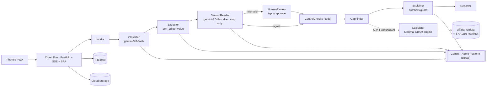

# Pramaan — CBAM proof from a phone photo

**Pramaan** (Hindi for *proof*) is an agentic AI copilot for small steel-goods exporters
(fasteners, wire, pipes). It turns **phone photos of bills, invoices and production logs** into
**verifier-ready EU CBAM embedded-emissions data**. Every number traces back to the exact region of
the source document. It also shows, in € and ₹, **what staying on EU default values costs the EU
buyer** — and which supplier's data would change that.

Built for the **Google Cloud AI Builder Cup 2026** (Manufacturing: Intelligent Operations &
Industrial Efficiency) by team **Innovative Warriors**.

**Live demo:** _deployment pending — see [docs/PROGRESS.md](docs/PROGRESS.md)_ · **3-min video:** _to be recorded_ ·
**Try it locally in 60 s:** see [Run locally](#run-locally)


<p align="center"></p>

## The problem

* The EU CBAM entered its **definitive (payment) phase on 1 January 2026**. EU importers now pay for
  the emissions embedded in steel imports. Without verified data they are priced on **default values
  with a mark-up of 10 % (2026), 20 % (2027), 30 % (2028+)**
  ([European Commission](https://taxation-customs.ec.europa.eu/carbon-border-adjustment-mechanism/cbam-legislation-and-guidance_en); EC Guidance No. 3, p. 115).
* An estimated **25,000–30,000 Indian MSMEs** are at risk. The EU takes **32–45 % of India's steel
  exports**, and exporters may need to cut prices by **15–22 %**
  ([Business Standard via Vision IAS, 29 Jan 2026](https://visionias.in/current-affairs/upsc-daily-news-summary/article/2026-01-29/business-standard/economy/india-eu-free-trade-agreement-cbam-rules-strain-indias-steel-msmes)).
* Compliance is reported to cost **₹15–20 lakh per MSME**, and India is working on a scheme to reimburse 90 %
  ([The Indian Express, reported 30 Jun 2026](https://www.kotakneo.com/news/market-news/india-msme-compliance-costs-eu-carbon-border-adjustment-mechanism-2026/)).
* European fastener distributors say a **verification bottleneck** is pushing importers onto default
  values in 2026 ([EFDA via Eurometal](https://eurometal.net/cbam-efda-calls-for-immediate-corrections-to-avoid-jump-in-production-costs-of-eu-products-assembled-with-imported-fasteners/)).
* The same problem hits exporters in Vietnam, China, Korea and Indonesia. Pramaan is built for JAPAC.

## What it does — three steps, one question each

| 1 · **Add your documents** | 2 · **What's missing?** | 3 · **Here's your proof** |
|---|---|---|
| Phone camera or upload. Live agent timeline. | Checklist per production process. Green: two readers agree. Amber: needs your tap. Red: missing or on defaults. EN / हिंदी / தமிழ் / Tiếng Việt. | SEE per CN group, Evidence Lens on every number, Precursor Lever, Money on the table, PDF / Excel / verifier pack, buyer link. |

| Evidence Lens | Blind two-reader check |
|---|---|
|  |  |
| Click any number → its formula → every value behind it → the highlighted region on the original photo, both readings, who approved it and when. | Gemini 3.8 Flash reads the page and boxes each value. Gemini 3.5 Flash-Lite re-reads **only the cropped region**, without seeing the first reading. When they disagree, a deterministic mass balance shows which reading closes. |

| Money on the table | Proof against the Commission's examples |
|---|---|
|  |  |

### The sample factory (fictional)

**Shivalik Fasteners Pvt Ltd (SAMPLE)**, Focal Point, Ludhiana, makes carbon-steel and stainless
hexagon bolts from purchased wire rod for a German buyer. It provides 24 photographed documents: gas
bills, electricity bills, rod invoices, a verified supplier statement, a Hindi production register,
a handwritten Punjabi/Hindi scrap log and export invoices. Its ratios mirror EC Guidance 5d
Example 3, so judges can check the numbers:

| | Carbon-steel bolts (CN 7318 15 82) | Stainless bolts (CN 7318 15 75) |
|---|---|---|
| SEE | **2.040 t CO2/t** (full precision 2.0399 = EC Example 3) | **8.889** — rod on India default 6.480 + 10 % |
| Rod share of SEE | 90 % | 98 % |
| Buyer cost 2026, actual vs default | **€45 vs €386 /t → €341/t (₹36,994/t) on the table** | €576 vs €402 /t — actual is *worse* than default |
| If the rod supplier sends verified data | — | SEE **2.371** (= EC G2), **€97/t** |

**Myth-buster:** the buyer does not pay "2.5 % of emissions" in 2026. The Commission's formula
subtracts a benchmark-based free allocation, so everything above the benchmark is payable. In EC
Example 1, 3,690 certificates are due on 15,670 t embedded: 23.5 %, not 5 %.

## How it works



* **ADK 2.11 Workflow** graph with route-based branching (mismatch → HumanReview). The Calculator is an ADK `FunctionTool`. Details: [docs/ARCHITECTURE.md](docs/ARCHITECTURE.md).
* **google-genai Interactions API** (`client.aio.interactions.create`): `response_format` JSON schema, `generation_config.thinking_level`, **high** media resolution for document images. `temperature`, `top_p` and `top_k` are never set, and only Gemini 3.x models are used (a test rejects 2.x / Veo / deep-research).
* **The LLM never computes a compliance number.** The Decimal engine does. The Explainer may only repeat numbers that exist in the calculation tree (guard + test).
* **No hand-typed regulatory values.** `backend/refdata/build_refdata.py` parses the Commission's default-values and benchmark Excel files, Guidance 3/4 tables, Implementing Decision 2026/1862 (CSCF) and the certificate-price page into JSON with a **SHA-256 manifest**. CI re-runs the parser and fails on drift. Anything else is an explicit, cited **assumption** shown as such in the UI (FX, MMBtu→GJ, NCV/GCV, projection price).
* **Rules copilot**: page-level retrieval over the official EC guidance plus Gemini 3.8 Flash grounded on those pages, with validated `[Guidance N, p. X]` citations. Without Gemini it still shows the cited passages.

### Google Cloud services
Cloud Run (asia-southeast1, min-instances 1, CPU boost) · Gemini Enterprise Agent Platform (`global`;
Gemini 3.8 Flash, Gemini 3.5 Flash-Lite) · Agent Development Kit 2.x · Firestore (Native) · Cloud
Storage · Cloud Build / Artifact Registry · Cloud Logging & Trace · IAM (dedicated least-privilege
service account, no API keys).

### Two-reader check, precisely
1. The Extractor returns every required field with `value`, `unit`, `box_2d = [ymin, xmin, ymax, xmax]` (0–1000), page and label.
2. For each field the region is cropped with 15 % padding, and **only the crop** goes to Gemini 3.5 Flash-Lite with the kind of value expected — never the first reading.
3. Readings are normalised (Indian digit grouping, decimal commas, unit aliases). Numbers must agree within **0.5 %**, and units must match after normalisation when visible. Agreement → `VERIFIED_2R` (green). Otherwise `NEEDS_REVIEW` (amber) with both readings and the crop. A human tap → `APPROVED` with user and timestamp, followed by a deterministic recalculation.
4. Readiness = share of SEE-relevant inputs that are `VERIFIED_2R` or `APPROVED`.

## Proof: EC examples reproduced (golden tests)

`backend/tests/test_golden_ec.py`, also run live on the **EC proof** page (`GET /api/golden`):

| ID | EC Guidance 5d (14 Aug 2026) | Expected | Pramaan |
|---|---|---|---|
| G1 | Example 3, carbon screws & nuts, Tables 4-12/4-13, p. 53 | SEE 2.039 (direct 0.196, precursor 1.843) | 2.0399 ✓ |
| G2 | Example 3, high-alloy screws & nuts, p. 53 | SEE 2.371 (precursor 2.175) | 2.3707 ✓ |
| G3 | Example 1, SEFA rails, Table 4-6 p. 43 / p. 44 | 1.261 → 1.198 (2027) | 1.2616 → 1.1985 ✓ |
| G4 | Example 1, certificates rails, p. 44 | EE 15,670 · FAA 11,980 · **3,690** | 3,690.0 ✓ |
| G5 | Example 2, certificates pipes, Table 4-11 / p. 51 | SEFA 0.867 · FAA 82.4 · **95.9** | 95.93 ✓ |
| G6 | Example 1, SEFA sheets & bars, p. 43 | 1.248 · 1.242 | 1.2486 · 1.2426 ✓ |
| G7 | Example 3, SEFA screws, Table 4-14 p. 54 *(additional)* | 1.499 · 1.159 | 1.4992 · 1.1587 ✓ |
| G8 | Benchmarks and gas EF re-read from the official files *(additional)* | 0.057, 0.038, 1.364, 1.154, 56.1 | exact ✓ |

Tolerance: ±0.002 t CO2/t (EC tables round intermediates to three decimals) and the stated
tolerance for certificates. Inconsistencies we found in the EC examples (e.g. FeCr SEE 2.280 vs
an implied 2.820) are logged in [docs/EC_EXAMPLE_NOTES.md](docs/EC_EXAMPLE_NOTES.md), not used as tests.

## Evaluation

`backend/eval/run_extraction_eval.py` runs the real workflow on the 24-document photographed set
(213 ground-truth fields with exact regions) and reports field accuracy, region hit rate (IoU ≥
0.5), two-reader agreement, human-review rate and time. The results appear on the **Metrics**
page; the full report is in [backend/eval/report.md](backend/eval/report.md).

| Run | Field accuracy | Two-reader agreement | Review rate | 24 docs → report |
|---|---|---|---|---|
| Live Gemini (3.8 Flash + 3.5 Flash-Lite) | _pending — needs project credentials_ | _pending_ | _pending_ | _pending_ |
| Replay of ground truth (harness self-check, **not a model score**) | 100 % | 99.5 % | 0.5 % | 1.3 s |

Every visitor who clicks **Load sample factory** gets a private copy of the sample (so judges never see each other's approvals); `scripts/ui_smoke.py` runs the whole flow in a logged-out browser on desktop and a 360 px phone in CI and after every deploy.

Agent scenarios (`backend/tests/test_agent_scenarios.py`, CI): skewed handwritten scrap log → HumanReview branch; Hindi-headed
register → activity levels; bill with two periods; missing supplier statement → default + Precursor Lever; mismatched unit →
review. The same five cases exist as an `adk eval` set for live runs ([backend/adk_eval](backend/adk_eval)).

## Run locally

Prerequisites: Python 3.12, Node 22 (20.11+ works), and on macOS `brew install pango` for PDF export.

```bash
git clone <repo> pramaan && cd pramaan
python3.12 -m venv backend/.venv && backend/.venv/bin/pip install -r backend/requirements-dev.txt
(cd frontend && npm ci && npm run build)
cd backend && DYLD_FALLBACK_LIBRARY_PATH=/opt/homebrew/lib .venv/bin/uvicorn app.main:app --port 8080
# open http://localhost:8080 → "Load sample factory"
```

Without Gemini credentials, runs replay the bundled sample and say so in the UI. For live Gemini,
use `gcloud auth application-default login` (Agent Platform), or set `GEMINI_MODE=api_key` and
`GEMINI_API_KEY` in `.env.local` (never committed). Tests: `cd backend && .venv/bin/pytest -q`.
Regenerate the sample documents with `backend/.venv/bin/python demo/generate_docs.py` and the refdata
with `.venv/bin/python -I refdata/build_refdata.py`.

## Deploy (Cloud Run)

```bash
scripts/gcp_setup.sh   # APIs, Firestore (asia-southeast1), private bucket, least-privilege service account, model check
scripts/deploy.sh      # golden tests → gcloud run deploy --source . → smoke test (health, sample, buyer link, golden)
```

## Repository

```
backend/   app/ (api, agents, cbam engine, evidence store, exports, copilot, demo) · refdata/ · tests/ · eval/ · adk_eval/
frontend/  React + Vite + TypeScript + Tailwind PWA (Evidence Lens, AgentTimeline, MoneyChart, GapChecklist, i18n)
demo/      factory.py · templates/ · generate_docs.py · out/ (24 photos) · ground_truth.json
docs/      BUILD_BRIEF · ARCHITECTURE · EC_EXAMPLE_NOTES · DEMO_SCRIPT · DECK_NOTES · PROGRESS · regulation/
```

## Limitations

* **Pramaan is not a substitute for an accredited verifier.** Outputs are provisional (year-to-date) until verified.
* The sample factory and all its documents are fictional and watermarked "SAMPLE — FICTIONAL".
* The live extraction metrics above are pending until the project's Gemini credentials are configured.
* Scope: iron & steel goods; other CBAM sectors are not modelled. No CBAM Registry integration, no payments, no user accounts.
* The Commission's Excel files are informational; the legally valid values are in the Official Journal.
* Projections beyond 2026 use an editable certificate-price assumption; CSCF after 2030 and benchmark (2) after 2030 are preliminary.

## License

MIT — see [LICENSE](LICENSE). EC documents © European Union, reused under Decision 2011/833/EU.
