# Pramaan — CBAM proof from a phone photo

**Pramaan** (Hindi for *proof*) is an agentic AI copilot for small steel-goods exporters
(fasteners, wire, pipes). It turns **phone photos of bills, invoices and production logs** into
**verifier-ready EU CBAM embedded-emissions data**. Every number traces back to the exact region of
the source document. It also shows, in € and ₹, **what staying on EU default values costs the EU
buyer** — and which supplier's data would change that. In the theme's words, it turns a factory's
operational data (bills, production registers, scrap logs) into insights (SEE per product and where
it comes from), recommendations (**what to do next**, with the money attached) and actions (the
supplier letter in English and Hindi, the buyer link, the operations levers).

Built for the **Google Cloud AI Builder Cup 2026** (Manufacturing: Intelligent Operations &
Industrial Efficiency) by team **Innovative Warriors**.

**Live demo:** [pramaan-646454690406.asia-southeast1.run.app](https://pramaan-646454690406.asia-southeast1.run.app) (Cloud Run, asia-southeast1) · **3-min video:** _to be recorded_ · **Deck:** [PDF](docs/deck/Pramaan-pitch-deck.pdf) (14 slides; the HTML version is [docs/deck/index.html](docs/deck/index.html)) ·
**Try it locally in 60 s:** see [Run locally](#run-locally) · **Two minutes?** On the live site press **Take the 90-second tour**: eight stops, from the verdict through a voice call to the Commission's examples. **One photo?** Open [`/try`](https://pramaan-646454690406.asia-southeast1.run.app/try) and watch two Gemini models read one page, or your own bill, in seconds.

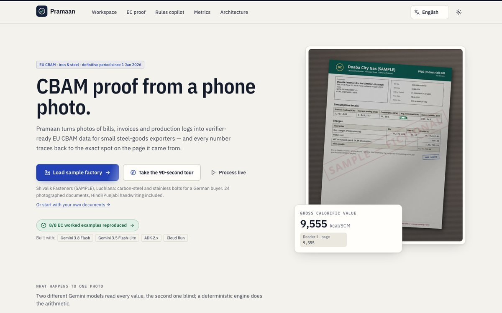

<p align="center">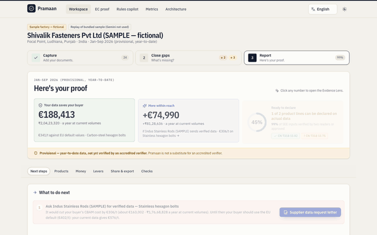</p>

## The problem

* The EU CBAM entered its **definitive (payment) phase on 1 January 2026**. EU importers now pay for
  the emissions embedded in steel imports. Without verified data they are priced on **default values
  with a mark-up of 10 % (2026), 20 % (2027), 30 % (2028+)**
  ([European Commission](https://taxation-customs.ec.europa.eu/carbon-border-adjustment-mechanism/cbam-legislation-and-guidance_en); EC Guidance No. 3, p. 115).
* An estimated **25,000–30,000 Indian MSMEs** are at risk. The EU takes **32–45 % of India's steel
  exports**, and exporters may need to cut prices by **15–22 %**
  ([Business Standard via Vision IAS, 29 Jan 2026](https://visionias.in/current-affairs/upsc-daily-news-summary/article/2026-01-29/business-standard/economy/india-eu-free-trade-agreement-cbam-rules-strain-indias-steel-msmes)).
* Compliance is reported to cost **₹15–20 lakh per MSME**, and India is working on a scheme to reimburse 90 %
  ([The Indian Express via Business Standard, 30 Jun 2026](https://www.business-standard.com/economy/news/carbon-border-adjustment-mechanism-cbam-eu-india-msme-exporters-126063000478_1.html)).
* European fastener distributors say a **verification bottleneck** is pushing importers onto default
  values in 2026 ([EFDA via Eurometal](https://eurometal.net/cbam-efda-calls-for-immediate-corrections-to-avoid-jump-in-production-costs-of-eu-products-assembled-with-imported-fasteners/)).
* The same problem hits exporters in Vietnam, China, Korea and Indonesia. Pramaan is built for JAPAC.

## What it does — three steps, one question each

| 1 · **Add your documents** | 2 · **What's missing?** (or answer by **voice** in Hindi / Punjabi / Tamil) | 3 · **Here's your proof** (or **call** it and ask out loud) |
|---|---|---|
| Phone camera or upload. Live agent timeline. Your own factory: type your product lines (every CN code checked against the official files as you type) or let the **ProductLines agent** propose them from your export and rod invoices. | Checklist per production process. Green: two readers agree. Amber: needs your tap. Red: missing or on defaults. EN / हिंदी / தமிழ் / Tiếng Việt (complete, checked in CI). | The answer first: **what your data saves your buyer a year, what more is within reach, how many product lines are ready**. Then **What to do next** with the money attached, SEE per CN group, Evidence Lens on every number, Precursor Lever, Money on the table, operations levers, PDF / Excel / verifier pack, buyer link. |

| What to do next | Operations levers |
|---|---|
| 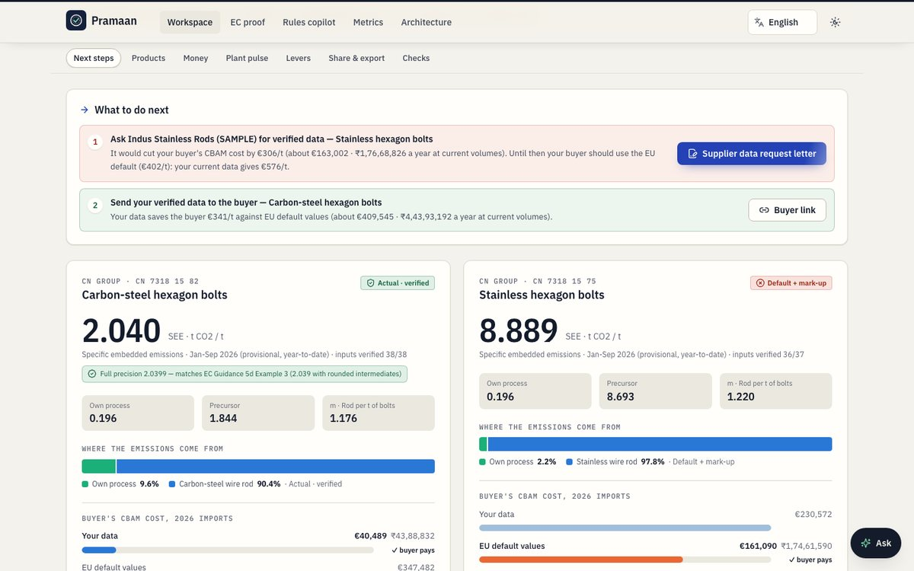 | 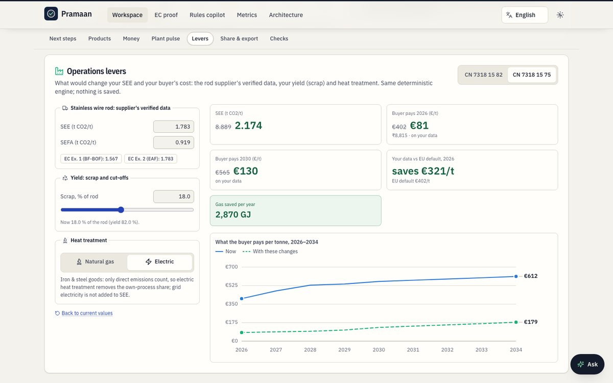 |
| The report opens with the verdict (your data saves the buyer €409,545 a year; €163,002 more is within reach; 1 of 2 product lines ready to declare) and then the decisions: ask Indus Stainless Rods for verified data (€306/t), one value to approve, send the carbon-steel data to the buyer (€341/t). The buyer's cost is the same number everywhere: the cheaper of your data and the EU default. | Rod supplier's verified data, scrap rate and heat treatment (gas per tonne or electric), computed by the same Decimal engine, with the rod and gas saved per year. Less scrap lowers SEE, but SEFA falls with it, so the 2026 cost moves little: the panel says so. |

| Evidence Lens | Blind two-reader check |
|---|---|
| 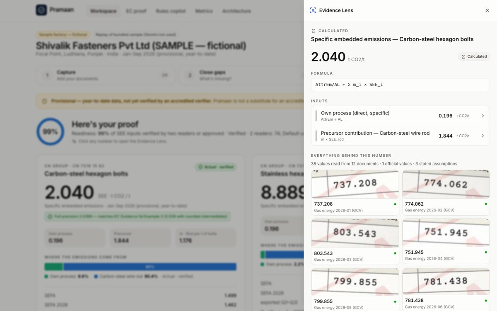 | 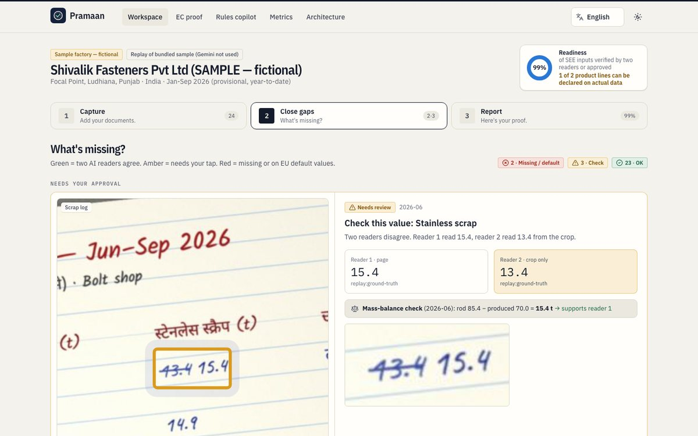 |
| Click any number → its formula → every value behind it → the highlighted region on the original photo, both readings, who approved it and when. | Gemini 3.8 Flash reads the page and boxes each value. Gemini 3.5 Flash-Lite re-reads **only the cropped region**, without seeing the first reading. When they disagree, a deterministic mass balance shows which reading closes. |

| Money on the table | Proof against the Commission's examples |
|---|---|
| 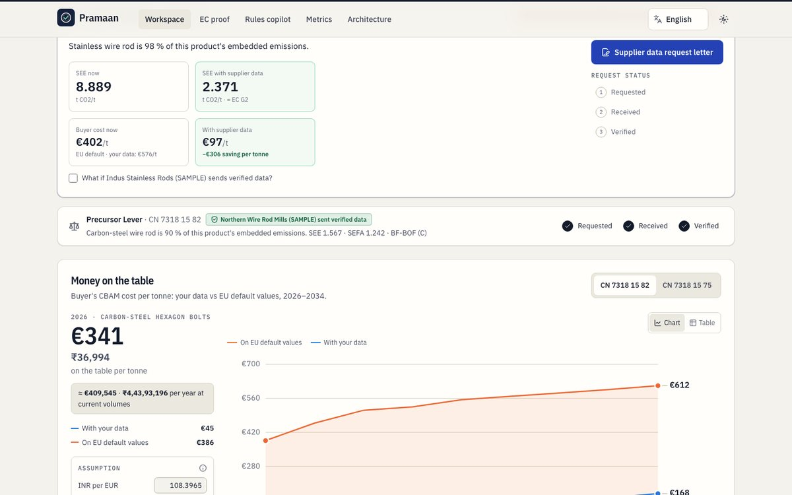 | 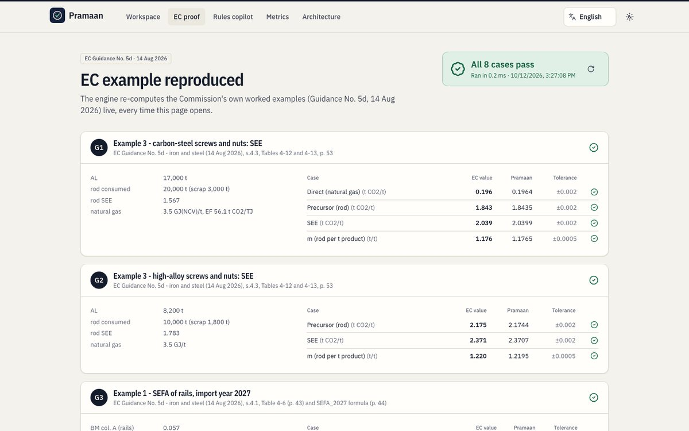 |

### Call Pramaan: talk to your report, in your language

The owner taps **Call** and talks to the report as on a phone call, in **English, हिंदी, ਪੰਜਾਬੀ, தமிழ் or
Tiếng Việt**: *"How much does my data save my buyer a year?"*, *"Why are my stainless bolts so much
higher?"*, *"Show me where the gas figure comes from."*, *"What is still left for me to do?"* Gemini 3.8
Live hears the question and answers out loud in about 1–2 s, and the caller can talk over it to interrupt.

| A call in Hindi: every figure it says appears and opens its proof | "Show me where it comes from": the agent opens the Evidence Lens itself |
|---|---|
| 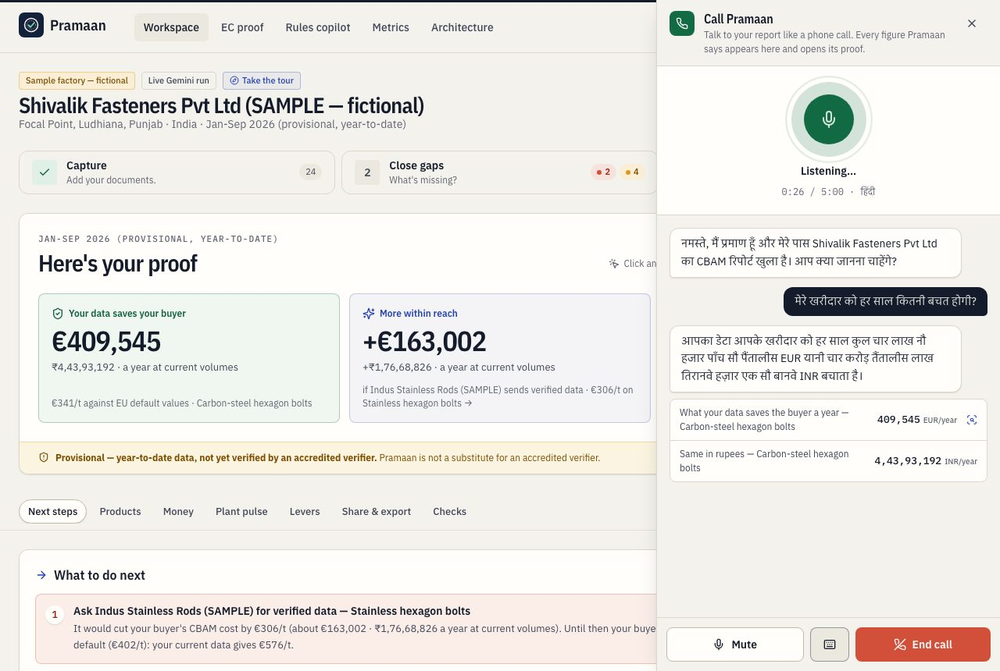 | 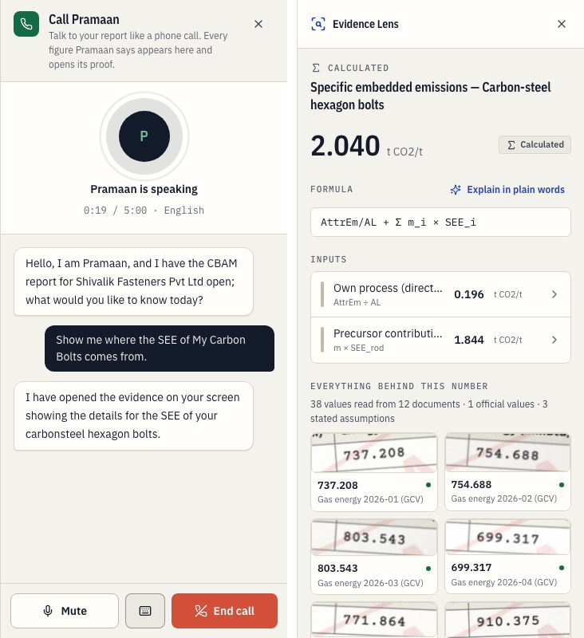 |

The same rules as everywhere else in Pramaan hold on the phone:

* **It answers from the engine, not from memory.** The agent gets the report's ~60 facts (each with its
  calculation-tree node) and four tools that run in our code, not in the model: `explain_number` (the
  formula and the values behind a figure, each with the document it was read from), `open_evidence`
  (opens the Evidence Lens on the caller's screen), `search_guidance` (the EC guidance pages) and
  `open_items` (what still needs the owner). It may not compute, and it cannot approve or send anything.
* **Every number it says is checked.** The server transcribes the agent's own voice, reads the numbers
  (digits in any script, English number words; for other languages Gemini Flash-Lite rewrites number
  words as digits after the answer) and matches them to the report: matched figures appear as cards that
  open the Evidence Lens, and a number that is not in the report is flagged on screen. A number rebuilt
  from words can add a card but never raise the warning, because a garbled transcript must not accuse a
  correct answer.
* **Credentials never reach the browser.** The browser streams 16 kHz microphone audio over a WebSocket to
  Cloud Run, which holds the Gemini Live session (Agent Platform, service account) and streams 24 kHz
  speech back. Calls are private like the project (passcode cookie), same-origin only, capped at 5 minutes
  and 20 calls per address per hour, and each call's length, turns, tools and unchecked numbers go to Cloud
  Logging. No recording is kept.

Tested live on 2026-10-13: spoken questions in English, Hindi, Tamil and Vietnamese (macOS voices, played
into Chrome as the microphone for the browser tests) and typed questions in Punjabi (macOS has no Punjabi
voice). Answers came in the caller's language, 1.1–2.3 s after the question, with the right figures
(€409,545 a year, SEE 8.889 with 8.693 from the rod), the Evidence Lens opened by voice, and no false warnings.

### Closing the loop: the supplier uploads, the money moves

For bolts made from bought wire rod, the rod is about 90 % of the embedded emissions, so the biggest
lever sits with the rod supplier. The request letter (English / हिंदी) carries a **supplier upload
link**: copy it or send it on WhatsApp. The supplier opens it on a phone with no account, sees only
what is asked and why, and uploads its verified CBAM communication. The same agents read it
(Classifier, Extractor, blind crop-only second reader, checks, Calculator) and the line switches
from the EU default to verified actual data. On the sample, Indus Stainless Rods' statement moves
the stainless bolts from **€402 to €97 per tonne** and the verdict from €409,545 to **€572,546 a
year, 2 of 2 product lines ready**, live on the exporter's open report. The supplier sees what was
read from its own document, never the exporter's plant data; the link can only add documents to that
one product line. On the fictional sample, *Open as the supplier* plays the supplier's side with a
bundled statement (`demo/supplier`).

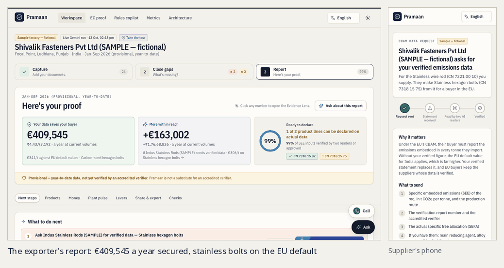

### Plant pulse: the same bills, read for efficiency

Manufacturing: intelligent operations. The gas bills and the production register that prove CBAM also
show how the furnace ran. **Plant pulse** plots heat-treatment gas per tonne month by month against the
plant's own median month and names the months that ran 10 % or more hot, with the excess in rupees at
each bill's own rate, in GJ and in t CO2. On the sample, June ran **+18.5 %**: **₹2,00,905** of gas above
the median month (135 GJ, 7.6 t CO2); April was the best month (3.26 GJ/t). Every figure is a node of the
calculation tree, so the Evidence Lens opens it down to the June bill and its printed rate. *Ask about this
report* knows these figures too ("Where is my plant wasting gas?").

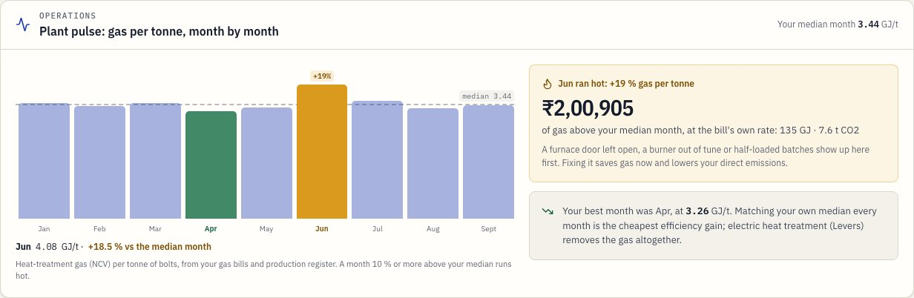

### Try one photo: two Gemini models, live, in seconds

For a judge with two minutes, or an exporter deciding whether to trust Pramaan with a year of bills:
[`/try`](https://pramaan-646454690406.asia-southeast1.run.app/try) runs the three reading steps of a full
run on **one page**, in front of you. Gemini 3.8 Flash classifies it and reads every value with its box;
the boxes appear on the photo, then Gemini 3.5 Flash-Lite re-reads each crop blind and each box turns
green (agree) or amber (a person checks). Select a value to see **exactly the crop the second reader saw**.
Pick one of three fictional samples (a gas bill, the handwritten Hindi/Punjabi scrap log, a rod invoice)
or take a photo of your own bill. Steps stream as server-sent events; the photo is read in memory and
never stored; tries are capped per address. Without Gemini the samples replay their recording, labelled
as a replay, and own photos are refused with a clear message.

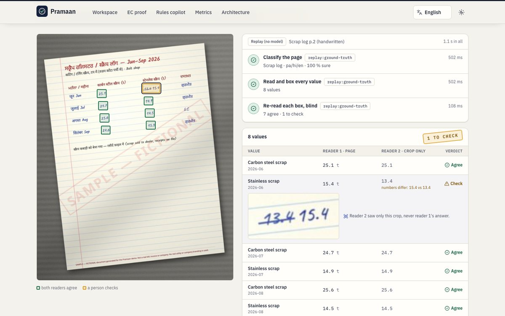

### Design: motion that explains

The "Mill Certificate" look (IBM Plex, paper and navy ink, statuses drawn as stamps) moves only
where the movement says something:

* **Computed numbers settle into place.** The verdict and SEE count up the first time you see them, and
  every lever value tweens when you change an input, so you see what moved and by how much.
* **Two readers, in order.** In the Evidence Lens and on the review card, reader 1's value appears,
  then reader 2's (crop only), then the verdict: ✓ agree, or ≠ with the mass-balance check lighting up
  the reading it supports.
* **Read here.** The photo glides to the value, the rest of the page dims, and a reading beam sweeps
  the box once.
* **Approved is a stamp.** Approving a value presses an *Approved* stamp onto the card before it folds
  away, a toast confirms the recalculation, and the readiness ring moves.
* **Where you are.** Drilling into a number slides forward and *Back* slides back, with a trail of
  the path; the steps and the report's section bar have a sliding highlight; the agent timeline fills
  as each agent finishes and documents show a scanner line while they are read.
* **Time flows left to right.** The money chart draws 2026 → 2034; lines morph when you switch
  product or turn on the supplier what-if.

**Phone first.** Bills live on the shop floor: on a laptop, Capture shows a *Continue on your phone* QR
code (a private project's passcode rides in the link's `#fragment`, which browsers never send to a
server; the phone unlocks with it and drops it from the address bar). The supplier link has its own QR
code, so the supplier — or a judge playing it — opens it on a phone while the laptop's report moves. On a
phone the report leads with the answers: each product line shows SEE and what the buyer pays, its
breakdown folds behind *Details*, and the levers and explanations fold behind one line each (the
sample report is 23 % shorter). Buyer and supplier links go out on WhatsApp in one tap.

**Fast on a phone.** English ships with the app; Hindi, Tamil and Vietnamese load when picked (13–15 KB
each), so the first load is 151 KB of JavaScript (gzip). The landing page paints a static copy of its
headline before the app starts, the stored theme is applied before the first paint, hero photos are
WebP, hashed assets are cached for a year. Lighthouse (landing page, local production build): **mobile
91 · 100 · 100 · 100**, **desktop 99 · 100 · 100 · 100** (performance · accessibility · best practices · SEO).

Everything respects *reduced motion* (numbers appear final, nothing slides), works at 360 px, in
light and dark, in all four languages, and passes axe (WCAG 2.1 A/AA: 0 violations on every page and
dialog).

### The sample factory (fictional)

**Shivalik Fasteners Pvt Ltd (SAMPLE)**, Focal Point, Ludhiana, makes carbon-steel and stainless
hexagon bolts from purchased wire rod for a German buyer. It provides 24 photographed documents: gas
bills, electricity bills, rod invoices, a verified supplier statement, a Hindi production register,
a handwritten Punjabi/Hindi scrap log and export invoices. Its ratios mirror EC Guidance 5d
Example 3, so judges can check the numbers:

| | Carbon-steel bolts (CN 7318 15 82) | Stainless bolts (CN 7318 15 75) |
|---|---|---|
| SEE | **2.040 t CO2/t** (full precision 2.0399 = EC Example 3) | **8.889** — rod on India default 6.480 + 10 % |
| Rod share of SEE | 90 % | 98 % |
| Buyer cost 2026, actual vs default | **€45 vs €386 /t → €341/t (₹36,994/t) on the table** | €576 vs €402 /t — actual is *worse* than default, so the buyer uses the default (€402/t) |
| If the rod supplier sends verified data | — | SEE **2.371** (= EC G2), **€97/t** |

**Operations levers:** try another rod supplier's verified data, a lower scrap rate, less gas per tonne or electric heat treatment (only direct emissions count for steel, so electric heating removes the own-process share). For the stainless bolts, EC-Example-2 supplier data plus electric heating gives SEE 8.889 → 2.174 and the buyer's cost €402 (EU default today) → €81 /t. For the carbon bolts, scrap 15 % → 10 % saves 111 t of rod a year and lowers SEE to 1.937, but the 2026 buyer cost moves only €45 → €43 /t, because the free allocation falls with the rod too.

**Myth-buster:** the buyer does not pay "2.5 % of emissions" in 2026. The Commission's formula
subtracts a benchmark-based free allocation, so everything above the benchmark is payable. In EC
Example 1, 3,690 certificates are due on 15,670 t embedded: 23.5 %, not 5 %.

## How it works

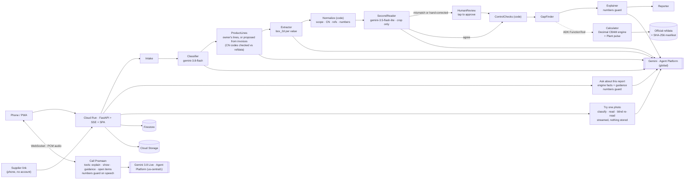

* **ADK 2.11 Workflow** graph with route-based branching (mismatch → HumanReview). The Calculator is an ADK `FunctionTool`. Details: [docs/ARCHITECTURE.md](docs/ARCHITECTURE.md).
* **ProductLines agent** sets up an exporter's own project: when no product lines are set, Gemini 3.8 Flash reads the export invoices (CN codes of the goods) and the rod invoices / supplier statements and proposes one line per exported CN code, linked to its steel input. Code validates every code against the official benchmark and default-value files (an aluminium code, for example, is rejected), and the owner confirms the lines before they count.
* **Private by default**: an exporter's own project gets a passcode (only a SHA-256 hash is stored) and an HttpOnly cookie scoped to that project; another device needs the passcode. The fictional sample copies stay open, and the buyer link shows the summary only. The owner can **delete the project for good** at any time (its photos in Cloud Storage, readings, runs, results, buyer and supplier links).
* **google-genai Interactions API** (`client.aio.interactions.create`): `response_format` JSON schema, `generation_config.thinking_level`, **high** media resolution for document images. `temperature`, `top_p` and `top_k` are never set, and only Gemini 3.x models are used (a test rejects 2.x / Veo / deep-research).
* **The LLM never computes a compliance number.** The Decimal engine does. The Explainer may only repeat numbers that exist in the calculation tree (guard + test).
* **No hand-typed regulatory values.** `backend/refdata/build_refdata.py` parses the Commission's default-values and benchmark Excel files, Guidance 3/4 tables, Implementing Decision 2026/1862 (CSCF) and the certificate-price page into JSON with a **SHA-256 manifest**. CI re-runs the parser and fails on drift. Anything else is an explicit, cited **assumption** shown as such in the UI (FX, MMBtu→GJ, NCV/GCV, projection price).
* **Rules copilot**: page-level retrieval over the official EC guidance plus Gemini 3.8 Flash grounded on those pages, with validated `[Guidance N, p. X]` citations. Without Gemini it still shows the cited passages.
* **Ask about this report** (in the workspace): questions about the factory's *own* figures ("Which of my product lines is on the EU default, and why?", "Which official default values apply to my products?"). Gemini 3.8 Flash answers from ~50 facts of the deterministic engine, each with its calculation-tree id, plus the relevant guidance pages and the official default values. Every number carries a chip that opens the Evidence Lens on that node; the Explainer's numbers guard withholds any answer with a number that is not in the report (and shows the report's figures instead). Without Gemini the same figures answer directly. In the Evidence Lens, **Explain in plain words** hands one number, its formula and its inputs to the same assistant.
* **Verifier spot-check** (`/p/{pid}/verify`, from Share & export): a verifier samples rather than re-reading every bill, so Pramaan draws the sample a verifier would (ISO 14065 / 14064-3 style): every value a person changed or approved, the supplier's own data, then production, rod consumed and bought, gas energy, scrap and exports by their weight in the result; fixed per project. Each value shows the exact crop of the photo it was read from; the verifier marks it as matching or not (with a note), the marks stay on the evidence with an audit entry, print as a record and go into the verifier pack (`spot_check.csv`). It answers the bottleneck in the problem statement: the verifier's desk review becomes a dozen crops checked in minutes instead of a year of paper (it does not replace the verifier's own procedure, site visits included).
* **Try one photo** (`/try`): the Classifier, Extractor and blind SecondReader calls of a full run on a single page, streamed step by step (server-sent events over a POST, uncompressed so each step lands at once). Same prompts, same normalisation, same comparison; at most 40 second reads per photo, 20 live tries per address and hour, nothing stored.

### Google Cloud services
Cloud Run (asia-southeast1, CPU boost, min-instances 1 during judging) · Gemini Enterprise Agent Platform (`global`;
Gemini 3.8 Flash, Gemini 3.5 Flash-Lite; Gemini 3.8 Live in `us-central1` for voice calls) · Agent Development Kit 2.x · Firestore (Native) · Cloud
Storage · Cloud KMS (EC P-256 key that signs every report's receipt) · Cloud Build / Artifact Registry · Cloud
Logging & Trace · IAM (dedicated least-privilege service account, no API keys).

### Two-reader check, precisely
1. The Extractor returns every required field with `value`, `unit`, `box_2d = [ymin, xmin, ymax, xmax]` (0–1000), page and label.
2. For each field the region is cropped with 15 % padding, and **only the crop** goes to Gemini 3.5 Flash-Lite with the kind of value expected — never the first reading.
3. Readings are normalised (Indian digit grouping, decimal commas, unit aliases). Numbers must agree within **0.5 %**, and units must match after normalisation when visible. Agreement → `VERIFIED_2R` (green). Otherwise `NEEDS_REVIEW` (amber) with both readings and the crop. A human tap → `APPROVED` with user and timestamp, followed by a deterministic recalculation.
4. Readiness = share of SEE-relevant inputs that are `VERIFIED_2R` or `APPROVED`, shown next to how many product lines can be declared on actual data (the sample: 99 % of inputs, but 1 of 2 lines, because the stainless rod is still on its default).

### Numbers the AI never invents, reports nobody can quietly change
**Every number is tied to its own source.** The engine computes every figure; Gemini only reads documents and puts
figures into words. Each AI answer is checked before anyone sees it:

| Where | The check | When it fails |
|---|---|---|
| Ask about this report | each number sits in a sentence citing the fact `[F:id]` that shows that very number, or a guidance page that prints it; a page the model was not given is not a source | one repair with the failing numbers named, then the answer is withheld and the facts answer instead |
| Rules copilot | each number, date or percentage is printed on the page cited in the same sentence | same: one repair, then the pages themselves |
| Narrative | a rewrite may use only its template's numbers and must keep the SEE | the template text is shown |
| Call Pramaan | each spoken number (from the transcript of its own audio, number words and Indian-script digits included) is one of the report's facts or something a tool just told it | flagged on screen, and the agent is told at once: it **corrects itself out loud** |

Being *somewhere* in the report is not enough. A review on 14 Oct 2026 measured the earlier rule: 41 of the 94
two-digit numbers were a rounding of one of the 380 nodes in the calculation tree, and the stainless line's SEE
said as the carbon line's passed. Live, 12 questions in English, Hindi, Tamil and Vietnamese: 11 answers passed
first time, 1 was repaired (two correct numbers cited to the wrong fact), none was withheld. Text that owners or
suppliers typed, and text written on a document photo, goes into prompts as data, never as instructions.

**Every change is on a hash chain, every report is signed.** Values read by a run, a value approved or changed by
hand, a verifier's spot-check mark and each report issued are entries in a change log where each entry carries the
SHA-256 of the one before (`app/evidence/ledger.py`): editing history breaks the chain. Each report that leaves
Pramaan (PDF, verifier pack, buyer link) carries a receipt (`app/evidence/attest.py`): a statement of the headline
figures, how each of the values behind them was confirmed (two readers / approved as read / **changed by hand** /
waiting), and SHA-256 fingerprints of the calculation tree, the values, every source photo, the reference data,
the change log's head and each file issued, signed with an EC P-256 key in **Cloud KMS** (the private key never
leaves KMS). The live service's key is `projects/copilot-manufacturing/locations/asia-southeast1/keyRings/pramaan/
cryptoKeys/report-signing/cryptoKeyVersions/1`, public-key fingerprint **`9451 0f5b bdf0 d336 3ef1 eef8 02c9 ff32`**
(SHA-256 of the DER key, as `/r/{id}` and every PDF show it): compare it here, not only on our own server. The receipt id is printed on the PDF; `/r/{id}` checks the signature *in the reader's own browser*
(WebCrypto), compares a dropped-in PDF byte for byte with the one issued, and lists anything changed since. The
verifier pack carries the statement, signature and public key, so a verifier checks it with no Pramaan at all:

```bash
openssl dgst -sha256 -verify receipt/public_key.pem -signature receipt/statement.sig receipt/statement.json   # Verified OK
```

## Proof: EC examples reproduced (golden tests)

`backend/tests/test_golden_ec.py`, also run live on the **EC proof** page (`GET /api/golden`):

| ID | EC Guidance 5d (14 Aug 2026) | Expected | Pramaan |
|---|---|---|---|
| G1 | Example 3, carbon screws & nuts, Tables 4-12/4-13, p. 53 | SEE 2.039 (direct 0.196, precursor 1.843) | 2.0399 ✓ |
| G2 | Example 3, high-alloy screws & nuts, p. 53 | SEE 2.371 (precursor 2.175) | 2.3707 ✓ |
| G3 | Example 1, SEFA rails, Table 4-6 p. 43 / p. 44 | 1.261 → 1.198 (2027) | 1.2616 → 1.1985 ✓ |
| G4 | Example 1, certificates rails, p. 44 | EE 15,670 · FAA 11,980 · **3,690** | 3,690.0 ✓ |
| G5 | Example 2, certificates pipes, Table 4-11 / p. 51 | SEFA 0.867 · FAA 82.4 · **95.9** | 95.93 ✓ |
| G6 | Example 1, SEFA sheets & bars, p. 43 | 1.248 · 1.242 | 1.2486 · 1.2426 ✓ |
| G7 | Example 3, SEFA screws, Table 4-14 p. 54 *(additional)* | 1.499 · 1.159 | 1.4992 · 1.1587 ✓ |
| G8 | Benchmarks and gas EF re-read from the official files *(additional)* | 0.057, 0.038, 1.364, 1.154, 56.1 | exact ✓ |

Tolerance: ±0.002 t CO2/t (EC tables round intermediates to three decimals) and the stated
tolerance for certificates. Inconsistencies we found in the EC examples (e.g. FeCr SEE 2.280 vs
an implied 2.820) are logged in [docs/EC_EXAMPLE_NOTES.md](docs/EC_EXAMPLE_NOTES.md), not used as tests.

## Evaluation

`backend/eval/run_extraction_eval.py` runs the real workflow on the 24-document photographed set
(222 ground-truth fields with exact regions) and reports field accuracy, region hit rate (IoU ≥
0.5), two-reader agreement, human-review rate and time. The results appear on the **Metrics**
page; the full report is in [backend/eval/report.md](backend/eval/report.md).

| Run | Field accuracy | Two-reader agreement | Review rate | 24 docs → report |
|---|---|---|---|---|
| Live Gemini (3.8 Flash + 3.5 Flash-Lite), 2026-10-13, the run the sample factory serves | **100 % (222/222)** | 99.5 % | 0.5 % (the hand-corrected 15.4) | 97 s |
| Live Gemini, all ten runs that day, while the fixes below went in | 89–100 % (each run and what it taught is on the Metrics page) | 97.7–99.5 % | 0.5–2.3 % | 72–309 s |
| Live Gemini, first run on Cloud Run (2026-10-12, before the clean-up; that day's 213-field set) | 83.6 % (178/213) | 98.6 % | 1.4 % | 392 s |
| Replay of ground truth (harness self-check, **not a model score**) | 100 % | 99.5 % | 0.5 % | 1.3 s |

**What the first live run taught us.** Gemini read almost every figure right; the misses were about
where a value was *filed*: supplier-statement values left without a product line (which moved the
carbon bolts from SEE 2.040 to 5.722), a month tag on an invoice number, a CN code inside a
description, a date appended to a reference, model notes written into a number and into the
classifier's dates. A deterministic clean-up driven by the field schema
([`normalize.py`](backend/app/agents/normalize.py)) now runs before the second reader: re-scoring the
same live readings gives **98.1 %** (209/213; the four left are steel grades read without the bar
size) and the engine reproduces the golden SEE 2.040. Speed: one extraction call stalled for 254 s,
so every Gemini call now has a time limit and a retry, and the Flash-Lite crop reads run in their
own lane. A figure corrected by hand on the page (crossed out, rewritten) always waits for a person,
even when both readers agree on it.

**What the second day of live runs taught us** (2026-10-13; Gemini Developer API from a laptop, same
models as on Cloud Run). Each run found one more way a correct reading could still go wrong, and each
is now a test in [`test_normalize.py`](backend/tests/test_normalize.py): an export line without its
quarter stopped the whole run (the quarter now comes from the invoice date, and an undated line is a
gap, never a crash); whole bills were read right but filed without their month (the month now comes
from the bill's own period); one extraction stalled past its time limit three times although the same
call answers in 13 s (a backup request now goes out after 30 s and the first answer wins); one looped
on a number followed by ~100 zeros and lost the rest of the bill (such an answer is read again); the
handwritten scrap log came back read right but with no month or product line on any figure (the page is
read again when most such values are untagged); the second reader read "380.000" right and then wrote
380000 itself, and a printed "Ref." label made two identical references "differ" (its printed digits
count, labels are stripped); a Tamil voice note came back in Kannada script (the language and script
are now named and checked).

Every visitor who clicks **Load sample factory** gets a private copy of the sample (so judges never see each other's approvals); `scripts/ui_smoke.py` runs the whole flow in a logged-out browser on desktop and a 360 px phone in CI and after every deploy.

Agent scenarios (`backend/tests/test_agent_scenarios.py`, CI): skewed handwritten scrap log → HumanReview branch; Hindi-headed
register → activity levels; bill with two periods; missing supplier statement → default + Precursor Lever; mismatched unit →
review; the slips of the first live run → cleaned before the engine; a hand-corrected figure both readers agree on → still a
human tap. The first five cases also exist as an `adk eval` set for live runs ([backend/adk_eval](backend/adk_eval)).

## Run locally

Prerequisites: Python 3.12, Node 22 (20.11+ works), and on macOS `brew install pango` for PDF export.

```bash
git clone <repo> pramaan && cd pramaan
python3.12 -m venv backend/.venv && backend/.venv/bin/pip install -r backend/requirements-dev.txt
(cd frontend && npm ci && npm run build)
cd backend && DYLD_FALLBACK_LIBRARY_PATH=/opt/homebrew/lib .venv/bin/uvicorn app.main:app --port 8080
# open http://localhost:8080 → "Load sample factory"
```

Without Gemini credentials, runs replay the bundled sample and say so in the UI. For live Gemini,
use `gcloud auth application-default login` (Agent Platform), or set `GEMINI_MODE=api_key` and
`GEMINI_API_KEY` in `.env.local` (never committed). Tests: `cd backend && .venv/bin/pytest -q`.
Regenerate the sample documents with `backend/.venv/bin/python demo/generate_docs.py` and the refdata
with `.venv/bin/python -I refdata/build_refdata.py`.

## Deploy (Cloud Run)

```bash
scripts/gcp_setup.sh   # APIs, Firestore (asia-southeast1), private bucket, least-privilege service account, KMS signing key, model check
scripts/deploy.sh      # golden tests → gcloud run deploy --source . → smoke test (health, sample, buyer link, golden, UI)
MIN_INSTANCES=0 scripts/deploy.sh   # same, but scale to zero between demos (the default 1 keeps it warm for judging)
```

On Cloud Run the health check is `GET /api/health`: the front end reserves some paths ending in
`z`, so `/healthz` (kept for local runs and CI) returns 404 there.

## Repository

```
backend/   app/ (api, agents, cbam engine, evidence store, exports, copilot, demo) · refdata/ · tests/ · eval/ · adk_eval/
frontend/  React + Vite + TypeScript + Tailwind PWA (Evidence Lens, AgentTimeline, MoneyChart, GapChecklist, i18n)
demo/      factory.py · templates/ · generate_docs.py · out/ (24 photos) · ground_truth.json
docs/      BUILD_BRIEF · ARCHITECTURE · EC_EXAMPLE_NOTES · DEMO_SCRIPT · DECK_NOTES · PROGRESS · regulation/ · deck/ (pitch deck, HTML + PDF)
```

## Limitations

* **Pramaan is not a substitute for an accredited verifier.** Outputs are provisional (year-to-date) until verified.
* The sample factory and all its documents are fictional and watermarked "SAMPLE — FICTIONAL".
* The live metrics come from the 24-document synthetic set. "Load sample factory" serves a captured live Gemini run
  (2026-10-13) and says so; a run on your own documents calls Gemini live.
* Scope: iron & steel goods; other CBAM sectors are not modelled. No CBAM Registry integration, no payments, no user accounts (own projects are protected by a passcode).
* The Commission's Excel files are informational; the legally valid values are in the Official Journal.
* Projections beyond 2026 use an editable certificate-price assumption; CSCF after 2030 and benchmark (2) after 2030 are preliminary.

## License

MIT — see [LICENSE](LICENSE). EC documents © European Union, reused under Decision 2011/833/EU.
