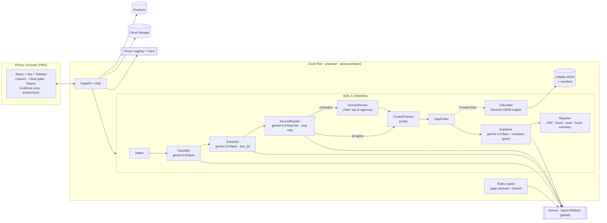

# Pramaan — architecture

One Cloud Run service (`pramaan`, asia-southeast1) serves the FastAPI API, the server-sent
event timeline and the built React PWA from a single container (one cold start). Gemini runs on
Gemini Enterprise Agent Platform at location `global` with the Cloud Run service account — no
API keys in production. State lives in Firestore (Native) and source photos in Cloud Storage.
Reference data is versioned JSON in the repo with a SHA-256 manifest.



## Agent contracts

All model outputs are JSON (Interactions API `response_format` with a JSON schema) parsed into
Pydantic models; every node emits timeline events (agent, action, input/output summary,
duration, model, tokens) that stream over SSE and are saved as the run receipt.

| Node | Engine | Output |
|---|---|---|
| Intake | code | documents for the run |
| Classifier | `gemini-3.8-flash`, medium media resolution, thinking low | `{doc_id, doc_type, languages[], period, title, confidence}` |
| Extractor | `gemini-3.8-flash`, **high** media resolution, thinking medium; per-doc-type field schema (`app/agents/schemas.py`) | `Field{field_key, value_text, value_num, unit, box_2d[ymin,xmin,ymax,xmax] 0-1000, page, label, period, process}` |
| SecondReader | `gemini-3.5-flash-lite`, thinking minimal, **only the 15 %-padded crop**, never the first reading | `{reading_value, reading_unit, agrees, delta}`; numbers within 0.5 %, units exact after normalisation → `VERIFIED_2R`, else `NEEDS_REVIEW` and the graph routes to HumanReview |
| HumanReview | UI task | amber values wait for a tap: `PATCH /api/projects/{pid}/evidence/{eid}` → `APPROVED` (user + timestamp) and deterministic recalculation |
| ControlChecks | code | `Check{name, formula, inputs, result, tolerance, status}` — mass balance (total and monthly), purchases vs consumption vs stock, gas invoice internal consistency, invoice coverage, exports ≤ production, export CN = process CN, supplier verification, electricity excluded |
| GapFinder | code (+ Calculator tool) | checklist per process and CN group, plain-language question per gap (i18n EN/HI/TA/VI), who to ask, suggested document; mass-balance hint for disagreements |
| Calculator | `app/cbam` (Decimal), exposed as an ADK `FunctionTool` | result + calculation tree: every node → evidence id (with region), refdata entry (with document, page, SHA-256) or a stated assumption |
| Explainer | `gemini-3.8-flash` (live) or template | sections with page citations; a guard rejects any number not present in the calculation tree |
| Reporter | code | PDF (WeasyPrint), Excel (openpyxl), verifier pack (zip), buyer summary |

## The LLM never computes a compliance number

Numbers enter the engine only from evidence records or refdata. The model reads and boxes
values; the Decimal engine computes SEE, SEFA, certificates and costs; the Explainer may only
repeat numbers that exist in the calculation tree (`tests/test_api.py::test_explainer_guard…`).

## Reference data

`backend/refdata/build_refdata.py` parses the official files listed in `sources.json`
(default values, benchmarks, Guidance 3 Annex D fuel factors and mark-ups, Guidance 4 CBAM
factors, Implementing Decision 2026/1862 CSCF, the EC certificate-price page) into
`refdata/json/*.json` and writes `manifest.json` (URL, download date, SHA-256, parser version).
`tests/test_refdata_manifest.py` fails if any file lacks a manifest entry or a hash drifts; CI
re-runs the parser and fails if the JSON changes. Values not in an official file live in
`assumptions.json` with `status: assumption` and a citation, and are shown as assumptions in
the UI.

## Storage model (Firestore)

```
projects/{pid}
  documents/{doc_id}   uri (gs://…), doc_type, languages, period, sha256, state
  evidence/{eid}       doc_id, page, field_key, value, unit, box_2d, extractor_model,
                       second_reading{…}, status, approved_by, approved_at, history[]
  runs/{run_id}        mode, status, events[], metrics{duration, tokens, two_reader}
  results/{run_id}     result_json (calc tree, SEE, SEFA, certificates, costs, readiness)
share_links/{token}    summary_snapshot (no plant-level inputs)
```

Locally (and in CI) the same interface is backed by an in-memory store with a JSON snapshot.

## Modes

* **live** — Gemini credentials present (Cloud Run service account or local ADC / API key).
* **replay** — no credentials: the bundled sample's ground truth is replayed through the same
  ADK graph and labelled `replay:ground-truth` everywhere. A live run can be captured as the
  demo cache with `python eval/run_extraction_eval.py --mode live --capture`.

## Scaling notes

`min-instances=1`, CPU boost, session affinity. Timeline events are persisted per event, so an
SSE stream served by another instance follows the run through Firestore. Runs are rate-limited
per project (`MAX_RUNS_PER_HOUR`).
